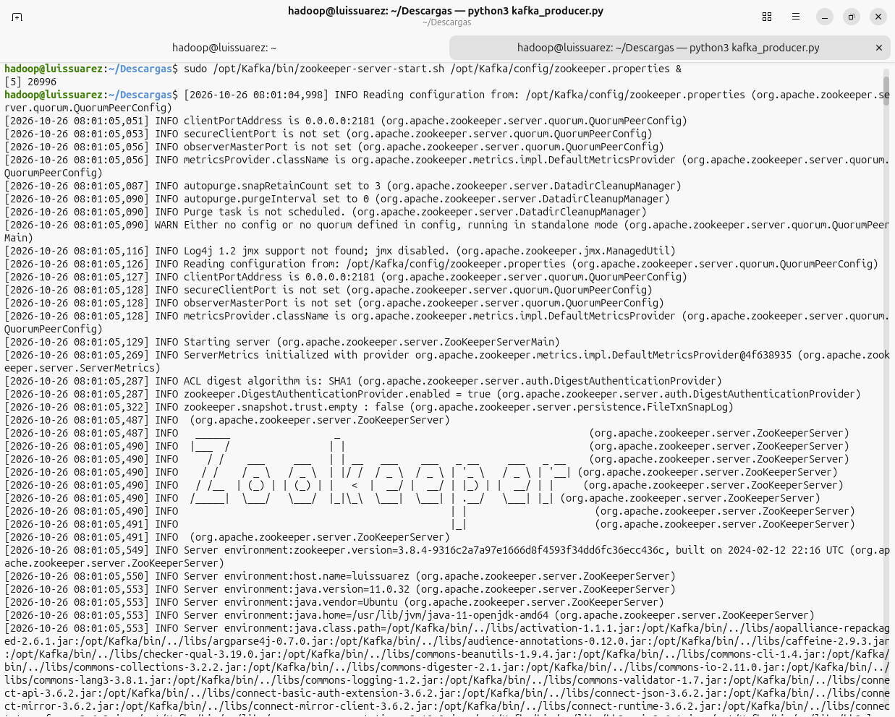
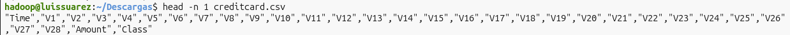
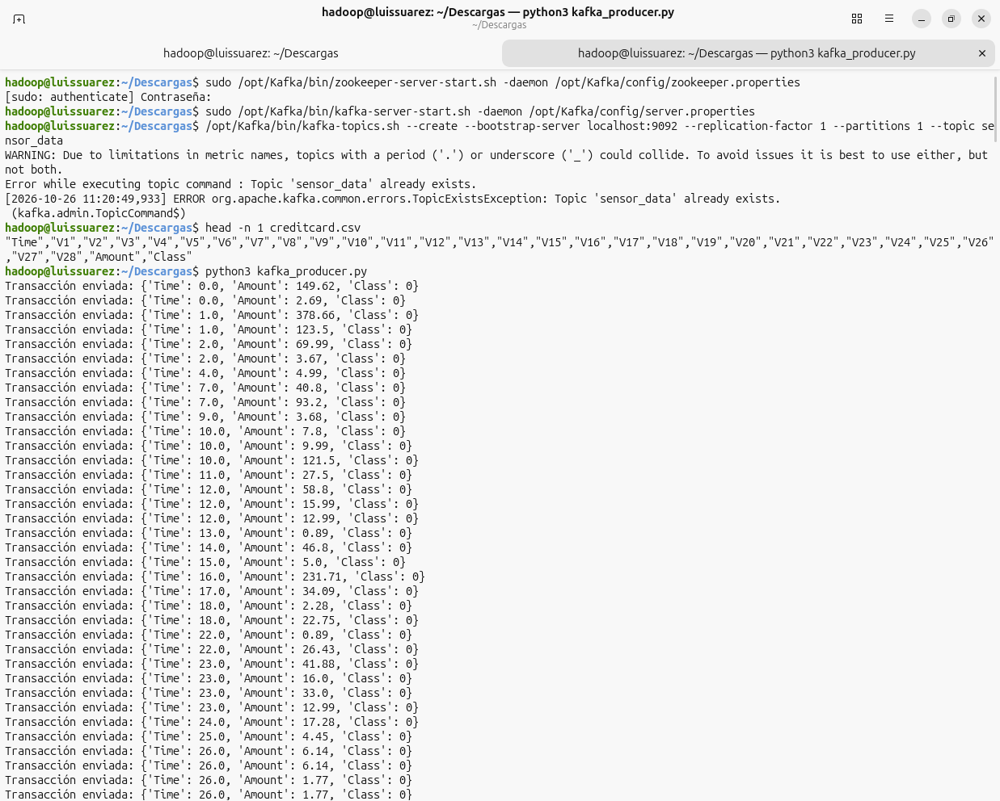
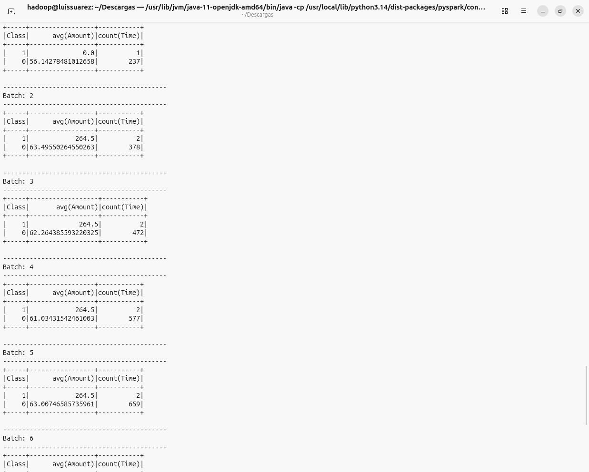

# Detección de Fraude Financiero con Apache Spark & Kafka

**Autor:** Luis Suárez

**Programa:** Ingeniería Industrial

**Institución:** Universidad Nacional Abierta y a Distancia (UNAD)

**Curso:** Big Data

**Fase:** Tarea 3: Procesamiento de Datos con Apache Spark

---
## 📋 Descripción del Proyecto
Este proyecto implementa un entorno de procesamiento distribuido en tiempo real para la detección de fraudes en transacciones con tarjetas de crédito. Se utiliza el dataset `creditcard.csv` (Kaggle) con 284.807 registros altamente desbalanceados.

## 🛠️ Arquitectura y Componentes
* **Apache ZooKeeper:** Coordinador de servicios del clúster.
* **Apache Kafka:** Broker de eventos distribuido (Topic: `sensor_data`).
* **Apache Spark (PySpark):** Procesamiento de micro-lotes en tiempo real mediante `SparkSession` y `readStream`.
* **Python 3:** Entorno de scripting para producción y consumo.

## 📁 Archivos Incluidos
* `kafka_producer.py`: Lee el archivo local de transacciones y las transmite progresivamente en formato JSON hacia Kafka.
* `spark_streaming_consumer.py`: Se suscribe al topic de Kafka, procesa los micro-lotes y calcula estadísticas agrupadas (promedio de monto y volumen por clase).
* `README.md`: Documentación técnica del repositorio.
  
## ⚙️ Requisitos

* Java 11
* Python 3
* Apache Spark 3.5.3
* Apache Kafka
* Dataset `creditcard.csv`, que debe descargarse de [Kaggle](https://www.kaggle.com/datasets/mlg-ulb/creditcardfraud) y colocarse en la carpeta del proyecto, ya que no se incluye en el repositorio por su tamaño.

## 🚀 Guía de Ejecución

1. **Iniciar la infraestructura:**
   ```bash
   sudo /opt/Kafka/bin/zookeeper-server-start.sh -daemon /opt/Kafka/config/zookeeper.properties
   sudo /opt/Kafka/bin/kafka-server-start.sh -daemon /opt/Kafka/config/server.properties
   /opt/Kafka/bin/kafka-topics.sh --create --bootstrap-server localhost:9092 --replication-factor 1 --partitions 1 --topic sensor_data
   ```

   

2. **Inspeccionar la estructura del dataset:**
   ```bash
   head -n 1 creditcard.csv
   ```

   

3. **Ejecutar el productor de eventos:**
   ```bash
   python3 kafka_producer.py
   ```

   

4. **Ejecutar el consumidor de Spark Streaming:**
   ```bash
   spark-submit --packages org.apache.spark:spark-sql-kafka-0-10_2.12:3.5.3 spark_streaming_consumer.py
   ```

   


## 📊 Análisis de Resultados en Tiempo Real

Como se observa en la captura de la consola durante la ejecución de los micro-lotes:
* **Procesamiento Continuo:** Spark Streaming recibe el flujo inyectado por el productor en el topic `sensor_data` y actualiza la tabla por cada intervalo.
* **Segmentación por Clase:** El sistema agrupa dinámicamente las transacciones legítimas (`Class = 0`) y los fraudes (`Class = 1`).
* **Cálculo de Métricas:** En cada micro-lote se recalcula en tiempo real el monto promedio (`avg(Amount)`) y el volumen total de eventos procesados (`count(Time)`), permitiendo detectar desviaciones sospechosas al instante.

---

## 💡 Conclusiones Técnicas

1. **Desacoplamiento de Ingesta:** La integración de Apache Kafka actúa como un buffer intermedio que absorbe picos de tráfico de transacciones sin impactar el rendimiento del motor de cómputo.
2. **Monitoreo en Tiempo Real:** Spark Streaming transforma el análisis tradicional de datos históricos en un esquema distribuido de bajo retardo, reduciendo el tiempo de respuesta ante fraudes financieros a milisegundos.
3. **Arquitectura Escalable:** El diseño basado en micro-servicios y contenedores de mensajería facilita escalar horizontalmente agregando más particiones al topic o nodos al clúster de Spark según la demanda transaccional.


